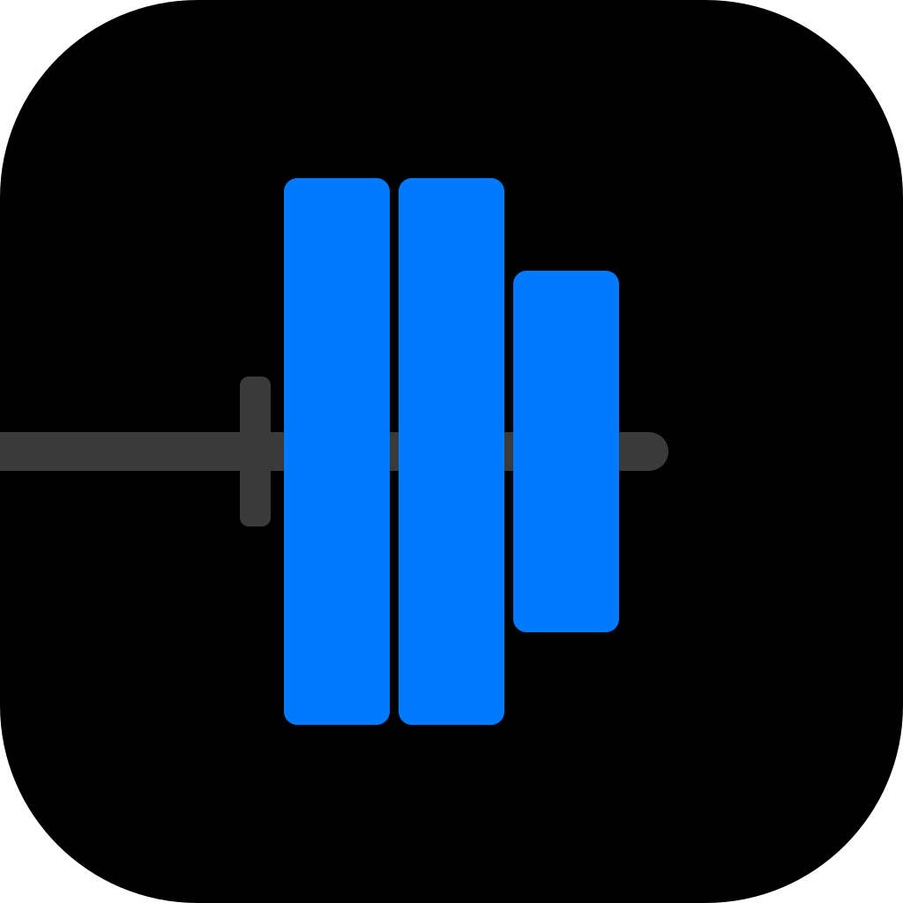
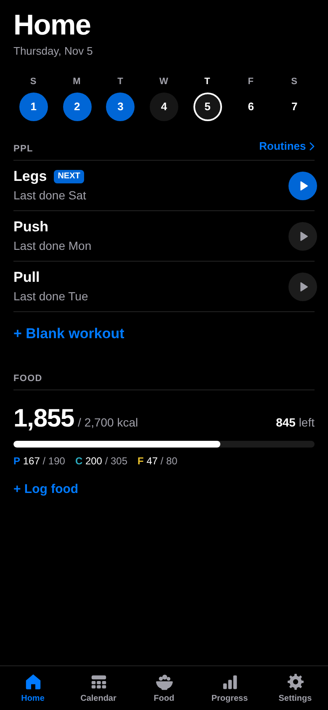
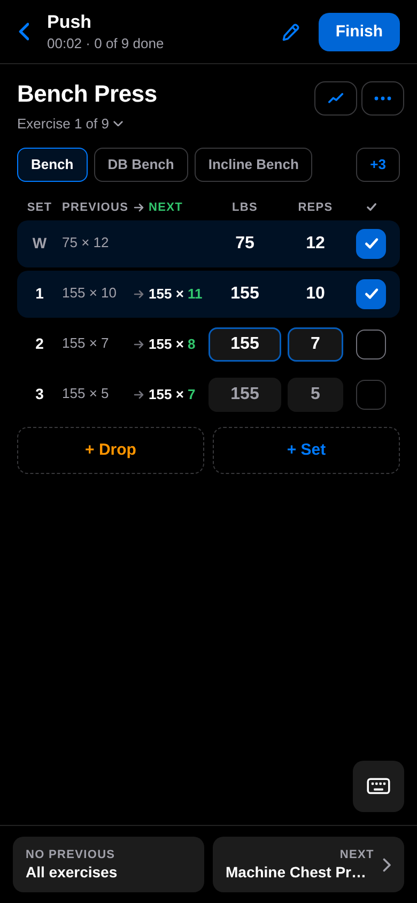
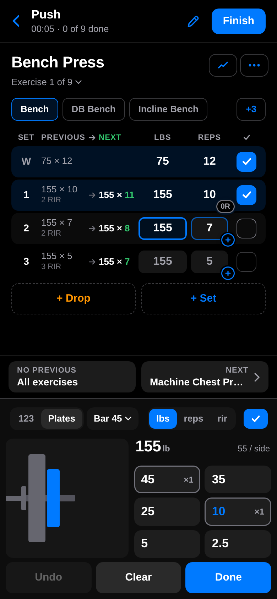
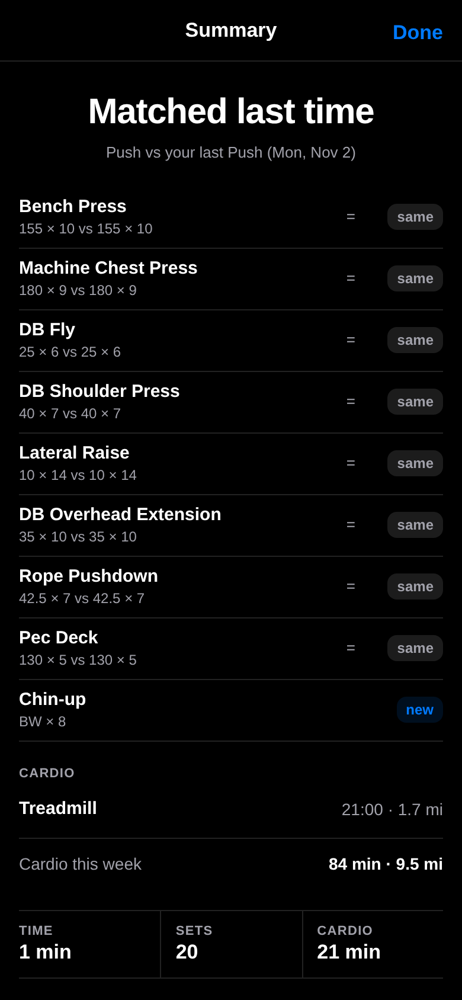
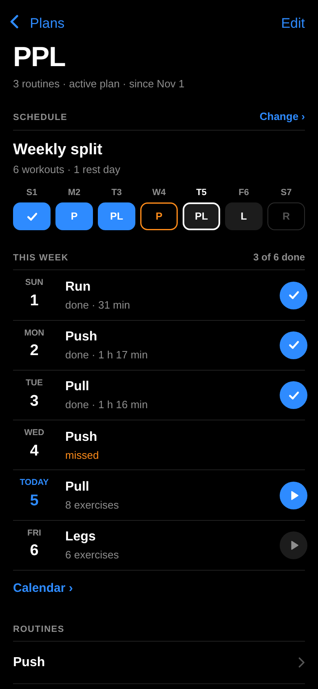
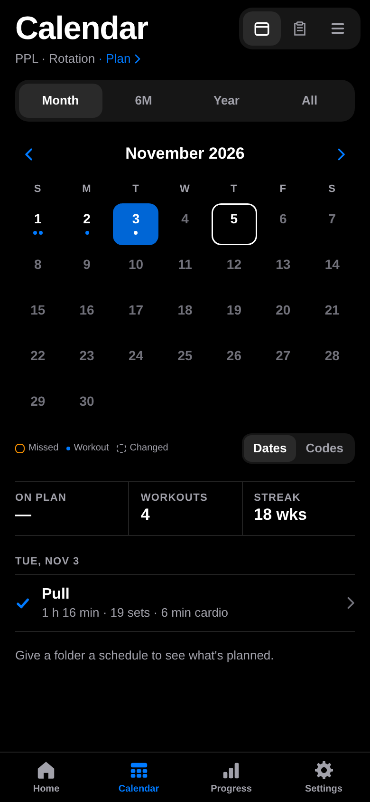
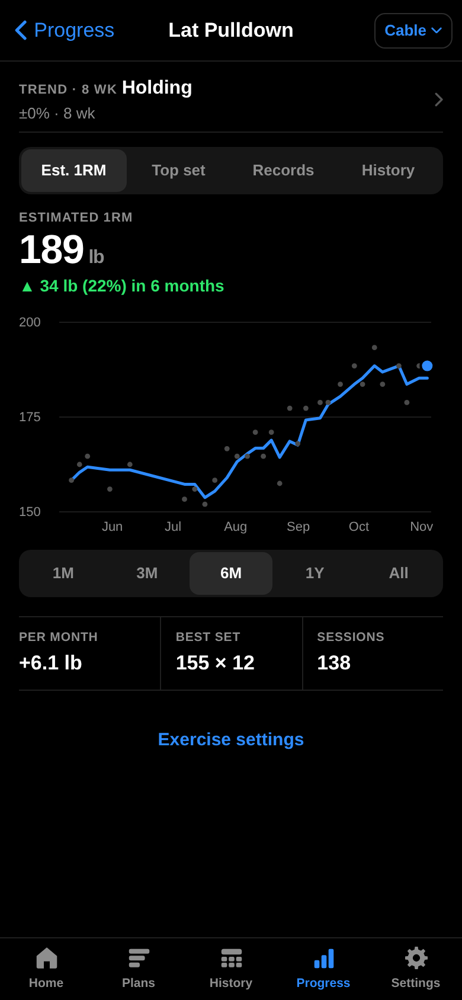
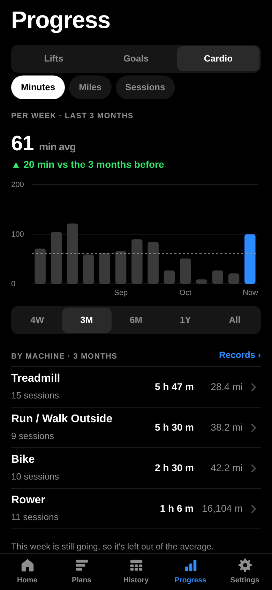

<p align="center"></p>

# OpenGym

A free lifting log that runs entirely on your phone. No account, no server, no ads, no subscription, and it works offline at the gym.

<p>
  
  
  
  
</p>
<p>
  
  
  
  
</p>

- **Plans.** Routines in folders. Give a folder a repeating cycle or weekly split and Home follows it; otherwise it suggests whatever you did longest ago.
- **Logging.** Every set pre-fills from last time. A custom keypad with a plate calculator, one-tap ✓, drop sets, warm-ups, supersets and cardio segments, with swipes and hold menus as shortcuts. Optional RPE / RIR effort per set, as a badge on the reps box.
- **Training.** Next-weight suggestions per set (Suggest or Auto, always with a Why), a status per lift (Climbing, Holding, Slipping…), goals with a projected date, milestones, a monthly review, and a ramp back after a break. All worked out on the phone from your own log.
- **History.** Month, 6-month, year and all-time calendars plus a searchable list. Past workouts can be edited.
- **Progress.** Est. 1RM, top-set and records charts for focus lifts, linked variations (Flat / Incline / DB), weekly cardio totals and running records.
- **Your data.** Backups are one JSON file. Import from Strong or Hevy CSV, export your own CSV.

Every screen is in [`design/storyboard.html`](design/storyboard.html), captured from the app.

## Run it

```bash
npm install
npm run dev        # http://localhost:5173 with sample data (also on your LAN, for a phone)
npm test           # unit tests for src/lib
npm run build      # type-check + production build into dist/
npm run preview    # serve dist/ locally
```

Requires Node 22.18 or newer. `npm run screens` and `npm run brand` regenerate the screenshots and brand assets in `design/` and need Chromium or Chrome.

On localhost the dev server uses a separate test database filled with sample history. A phone on your LAN, `npm run dev:real` and production builds use the real one.

## Deploy

`npm run build` produces a static site in `dist/` that works from any static host or sub-path (relative paths, hash routing).

- **Cloudflare:** `npx wrangler deploy` (config in `wrangler.jsonc`).
- **Netlify / Cloudflare Pages / Vercel:** build command `npm run build`, output directory `dist`.
- **GitHub Pages:** publish `dist/` (for example with `actions/deploy-pages`).

Serve it over **HTTPS**, or the service worker (offline support and install) won't run.

## Install on iPhone

1. Open the site in **Safari**.
2. Tap **Share**, then **Add to Home Screen**.
3. Open OpenGym from the Home Screen icon, not from Safari.

Installed, it runs full screen and offline, and iOS is much less likely to clear its storage. **Settings → Back up now** saves a single file you can keep in iCloud Drive. On Android / Chrome, use **Install app** from the browser menu.

## Where things are

| Path | What |
| --- | --- |
| `design/` | The spec (`SPEC.md`), the training rules (`training-logic.html`), the screen storyboard and brand assets |
| `src/db/` | Data model, Dexie schema, built-in exercise library |
| `src/lib/` | Pure logic with tests: 1RM, records, prefill, next-up, schedules, supersets, cardio, plates, effort, import |
| `src/lib/training/` | Suggestions, lift trends, goals and milestones (ported from `design/training-logic-reference.py`) |
| `src/data/` | Reads and writes, history index, backup / restore / import |
| `src/components/` | Shared UI, overlays, keypad, plate pad, gestures, charts, icons |
| `src/screens/` | One folder per area: onboarding, home, plans, workout, history, progress, exercises, settings |
| `scripts/` | Screenshot and brand generators |

Your data stays in the browser's IndexedDB on your device. Nothing is ever sent anywhere.
