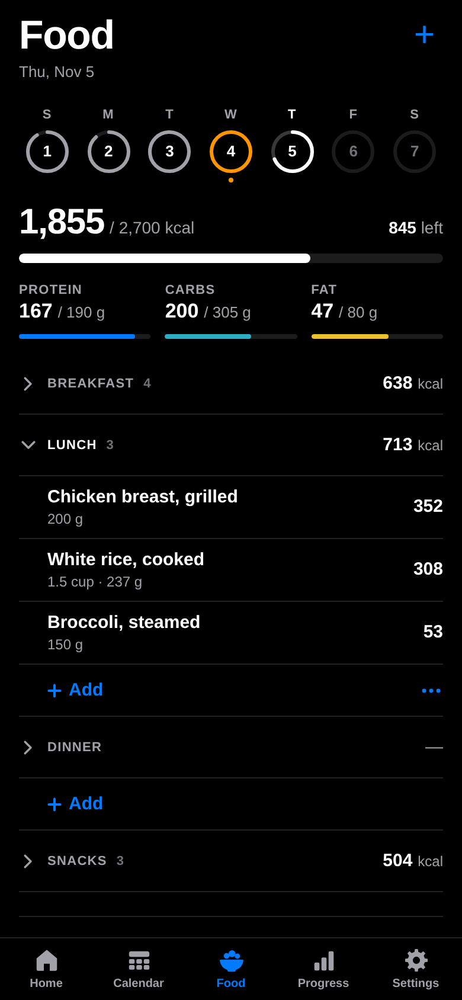
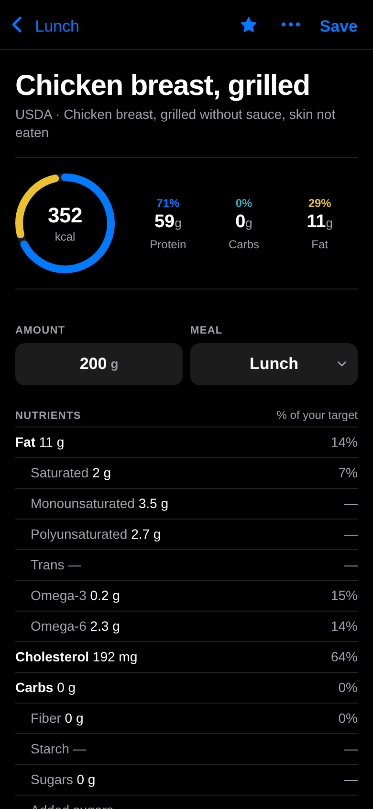

<p align="center"></p>

<h1 align="center">OpenGym</h1>

<p align="center">A free lifting and food log that runs entirely on your phone.<br>No account, no server, no ads, no subscription. Works offline at the gym.</p>

<p align="center">
  
  
  
  
</p>
<p align="center">
  
  
  
  
</p>

## Features

- **Plans**: routines in folders with an optional weekly split or repeating cycle; Home shows what's next.
- **Logging**: every set pre-fills from last time. Includes a custom keypad, a plate calculator, warm-ups, drop sets, supersets, cardio and optional RPE / RIR.
- **Training**: next-weight suggestions with a reason, a trend for each lift, goals with a projected date, milestones and a monthly review.
- **History & Progress**: calendars, a searchable list, est. 1RM and records charts, and cardio totals.
- **Food**: calories, macros and micronutrients against your own targets. Search about 13,000 USDA foods offline, or scan a barcode (Open Food Facts).
- **Your data**: back up to a single JSON file, import from Strong or Hevy, export to CSV.

Every screen is in [`design/storyboard.html`](design/storyboard.html), captured from the app.

## Quick start

Requires Node 22.18+.

```bash
npm install
npm run dev       # http://localhost:5173, sample data in a separate test database
npm test          # Vitest
npm run build     # typecheck + design lint + production build into dist/
npm run preview   # serve dist/
```

`npm run dev:real` uses the real database. `npm run screens -- <ids>` re-captures the screenshots (needs Chrome or Chromium).

## Deploy

`dist/` is a static site that works from any host or sub-path. Serve it over **HTTPS**, or offline mode and install won't work.

- **Cloudflare Workers:** `npx wrangler deploy` (uses `wrangler.jsonc`)
- **Netlify / Cloudflare Pages / Vercel:** build `npm run build`, output `dist`
- **GitHub Pages:** publish `dist/`

## Install on iPhone

Open the site in **Safari**, then go to **Share → Add to Home Screen**, and launch OpenGym from that icon. Installed, it runs full screen and offline, and iOS is much less likely to clear its storage. To keep a copy, use **Settings → Back up now** and save the file to iCloud Drive. On Android, use **Install app** in Chrome's menu.

## Privacy

All data lives in IndexedDB on your device. The only network calls are Open Food Facts searches and barcode lookups, made when you're online. You can turn them off in Settings › Food.

## Project docs

| Path | What |
| --- | --- |
| [`design/SPEC.md`](design/SPEC.md) | Rules, data model, design principles |
| [`design/DESIGN.md`](design/DESIGN.md) | Design tokens and component catalog |
| [`design/ROADMAP.md`](design/ROADMAP.md) | Known bugs and what's next |
| [`AGENTS.md`](AGENTS.md) | Code layout, commands and conventions (for contributors and coding agents) |
